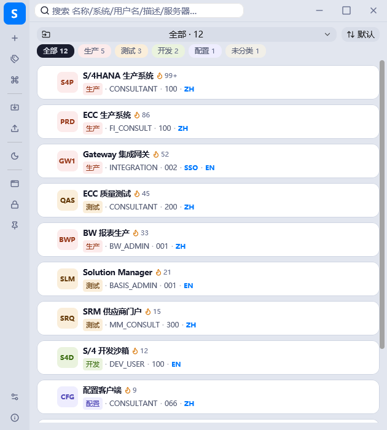
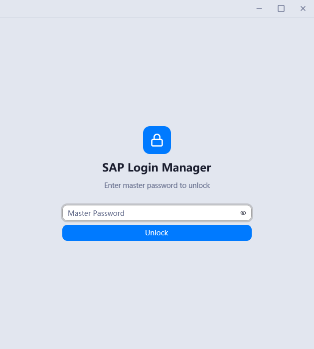
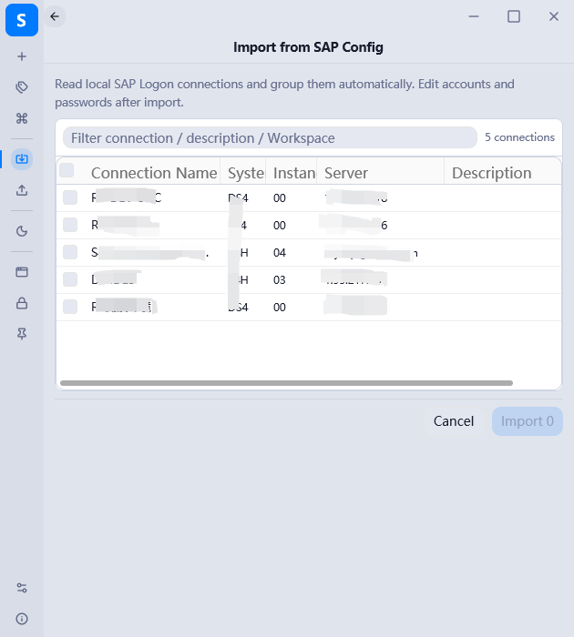

# SAP Login Manager

**简体中文** | [English](#english)

<p align="center">
  一款为 SAP 顾问与运维人员打造的<strong>本地化、加密存储、一键登录</strong>桌面凭据管理工具。
</p>

<p align="center">
  
  
  
  
  
</p>

---

## 📖 简介

**SAP Login Manager** 是一个 **Rust 原生（GPUI）** 的轻量级 Windows 桌面应用，用于集中管理 SAP 系统的登录凭据：所有数据使用 **AES-256-GCM** 加密后**保存在本地**（无任何云端上传），支持从 `SAPUILandscape.xml` 导入连接、一键 / 批量启动 SAP Logon 登录，帮助你告别重复手动输入账号密码。

在开源生态中，现有的 SAP 自动化项目要么没有 GUI（CLI / 脚本 / MCP），要么凭据明文存于 CSV / JSON。本项目的差异化定位：

> **唯一同时具备「完整图形界面 + 强加密存储 + 一键登录」的开源 SAP 登录管理器**，且保持原生级资源占用（实测任务管理器内存约 17–20 MB，完整工作集含共享库约 50 MB；无 WebView 运行时）。

> 🔒 **隐私优先**：凭据仅存储在你自己的电脑上，密钥由主密码派生，明文密码永不落盘。

---

## ✨ 核心功能

### 凭据管理
- 增删改查 SAP 连接凭据：显示名称、System ID、集团（Client）、登录语言、环境、描述、应用服务器 / 消息服务器（负载均衡）、SAP Router、SNC / SSO
- **删除可撤销**（Undo 恢复），复制副本快速新建
- 复制密码一键完成，卡片上原地反馈 ✓

### 分组与筛选
- 按环境（正式 / 测试 / 开发 / 配置）系统分组 + 自定义分组，分组间移动凭据
- 分组下拉带数量徽标、分区可折叠，支持指定**启动默认分组**
- 收藏、置顶（卡片图钉标识）、四种排序方式（默认 / 常用 / 最近登录 / 名称）

### 搜索
- 全字段全局搜索（名称 / 系统 / 集团 / 用户名 / 服务器 / 描述 / 分组名…）
- **结构化语法**：`env:生产`（支持中英文别名）、`grp:分组名`，可叠加过滤

### 登录与自动化
- 一键启动 SAP Logon 并自动填充登录，双击卡片即登录
- **批量登录**：多选（勾选 / Ctrl / Shift 范围选）后逐条执行，可配置间隔，汇总成功明细
- 标题栏一键打开 SAP Logon：运行中自动置前台，未运行则启动；SAP Logon 路径可自定义
- 从 `SAPUILandscape.xml` 导入连接
- SNC 单点登录（SSO）凭据支持，负载均衡 / SAP Router 连接串

### 安全
- 主密码保护；密钥派生**版本化路由**：新库直接使用 **Argon2id**（19 MiB / t=2），旧版（PBKDF2 600k）库在解锁时自动安全升级
- 数据 **AES-256-GCM** 加密（带完整性认证）
- **免密模式（Windows DPAPI）**：主密码密文与当前 Windows 账户绑定，离开本机 / 本账户无法解密
- 主密码运行时以 `SecretString` 保存，销毁时内存清零（zeroize）
- 剪贴板定时自动清空（可配置）、空闲自动锁定（时长可配置，0 为禁用）
- 备份导出 / 导入（加密凭据包），便于迁移与灾备

### 体验
- 中文 / English 双语界面，亮色 / 暗色主题（活动栏一键切换）
- 左侧活动栏集中入口：分组管理、导入 / 导出、主题切换、打开 SAP Logon
- 环境色标识（左缘色条 + 浅底头像 + 环境标签，色弱友好）
- 命令面板（`Ctrl+K`）、应用内快捷键（`Ctrl+N` 新增 / `Ctrl+F` 搜索 / `Ctrl+L` 锁定）、键盘导航（`↑↓` 选择 / `Enter` 登录）
- **全局热键 `Ctrl+Shift+S`**：任意界面唤起窗口并弹出命令面板（Raycast 式入口）
- 系统托盘（左键唤起主窗口；最小化 / 关闭到托盘可配置）、开机自启、紧凑密度模式
- 窗口置顶开关、界面字体自定义

---

## 🖼️ 界面预览

<p align="center">
  <picture>
    <source media="(prefers-color-scheme: dark)" srcset="gpui-version/demo-data/screenshot/main-dark-en.png">
    
  </picture>
</p>

<p align="center">
  &nbsp;&nbsp;
  
</p>

> 截图由 `demo-data/` 演示实例生成（12 条演示凭据，测试主密码见 `demo-data/使用说明.txt`）。

---

## 📦 目录结构

本仓库包含三个实现版本（共享同一数据格式）：

| 目录 | 版本 | 状态 |
|---|---|---|
| `gpui-version/` | **GPUI 原生版**（Rust + gpui-kit，GPU 加速自绘 UI） | ✅ 当前主力开发版本 |
| `tauri-version/` | Tauri 2 + React + TypeScript 版 | 🗄 参照实现，可独立构建（CI 使用） |
| `slint-app/` | Slint 版 | 🧪 技术探索 |
| `archive/` | 历史归档（设计稿预览页、旧截图、特性规格） | 📦 仅存档 |

- **GPUI 版构建**：仓库根执行 `.\build-gpui.ps1 [check|build|run] [debug|release]`，详见 `gpui-version/README.md`
- **Tauri 版构建**：`tauri-version/` 内 `npm install && npm run tauri build`

---

## 🚀 快速开始（GPUI 版）

### 环境要求
- Windows 10/11
- [Rust](https://www.rust-lang.org/tools/install)（stable 工具链）

### 构建与运行
```powershell
.\build-gpui.ps1 check          # 快速编译检查
.\build-gpui.ps1 build release  # release 构建
.\build-gpui.ps1 run            # 编译并运行
```
或直接使用 cargo：
```powershell
cargo build --release -p sap-login-manager-gpui
```

### 数据存储
- 数据文件位于 **exe 同目录 `data/store.json`**（便携模式，拷贝目录即迁移）
- ⚠️ 请勿在源码目录内正式使用（`cargo clean` 会连带清空）；建议将 exe 与 `data/` 复制到独立目录

---

## 🧱 技术栈（GPUI 版）

| 层 | 技术 |
| --- | --- |
| UI 框架 | [GPUI](https://gpui.rs)（Zed 的 GPU 加速自绘框架）+ [gpui-kit](https://github.com/longbridge/gpui-component) 组件库 |
| 后端 | Rust（stable），workspace：`sap-backend`（业务/加密）+ `sap-login-manager-gpui`（UI） |
| 加密 | AES-256-GCM、Argon2id / PBKDF2-HMAC-SHA256（KDF 版本路由）、Windows DPAPI |
| 存储 | 本地 JSON（`data/store.json`，便携化） |
| 托盘/自启 | tray-icon + 注册表（HKCU Run 键，路径自愈） |

---

## 🔐 安全说明

- 主密码**不会**以任何形式明文存储，仅保存其哈希用于校验；加密密钥由主密码 + 随机盐经 KDF 派生。
- **KDF 版本化路由**：v0 = 旧版格式，v1 = PBKDF2（600,000 轮），v2 = **Argon2id**（19 MiB / t=2，当前最新）。设置或修改主密码、以及每次解锁时，旧版本库自动原子迁移到最新版（重加密过渡）。
- 所有凭据密码使用 AES-256-GCM 加密，具备防篡改完整性认证。
- **免密模式**通过 Windows DPAPI 加密主密码，密文与当前 Windows 用户账户绑定：即使 `store.json` 被复制到其他电脑或账户，也无法解密。
- 主密码与解密密码在内存中以 `SecretString` / zeroize 管理，Drop 时清零，`Debug` 输出打码。

---

## ⚠️ 免责声明

- 本项目是**个人开源项目，与 SAP SE 无任何隶属、合作或认可关系**。"SAP" 及相关标识为 SAP SE 的商标或注册商标，本项目仅调用其客户端软件，名称引用仅用于描述兼容性。
- 本工具用于保管企业系统凭据并**自动登录目标系统**。请使用者自行确认符合所在组织的信息安全政策与法律法规；因使用本工具产生的合规责任由使用者自行承担。
- 数据仅保存在本地，**忘记主密码将无法恢复**；请定期使用内置备份导出功能自行备份。对因数据丢失、损坏或泄露造成的任何直接或间接损失，作者不承担责任。
- 本项目按"现状"提供，不提供任何形式的明示或默示担保。**使用本项目所产生的一切后果由使用者自行承担，与本项目作者无关。**
- 本项目仅供学习研究与合法用途。

---

## 🤝 反馈

- 问题与建议：[GitHub Issues](https://github.com/sfhzyq/SAP-Login-Manager/issues)
- 邮箱：`sfhzyq@qq.com`

## 📄 许可证

本项目采用 [MIT](./LICENSE) 许可证。

---

# English

[简体中文](#sap-login-manager) | **English**

<p align="center">
  A <strong>local-first, encrypted, one-click logon</strong> desktop credential manager for SAP consultants and administrators.
</p>

<p align="center">
  
  
  
  
  
</p>

## Introduction

**SAP Login Manager** is a lightweight native **Rust (GPUI)** Windows desktop app for centrally managing SAP logon credentials. All data is encrypted with **AES-256-GCM** and **stored locally** (no cloud upload ever). It imports connections from `SAPUILandscape.xml` and launches SAP Logon with one click — single or batch — so you can stop retyping usernames and passwords.

Unlike existing open-source SAP automation projects (CLI/script/MCP with no GUI, or credentials in plain CSV/JSON), this project aims to be:

> **The only open-source SAP logon manager that combines a full GUI + strong encrypted storage + one-click logon**, while staying native-grade lightweight (~17–20 MB memory, no WebView runtime).

> 🔒 **Privacy first**: credentials live only on your machine; keys are derived from your master password; plaintext passwords never touch disk.

## Screenshots

<p align="center">
  <picture>
    <source media="(prefers-color-scheme: dark)" srcset="gpui-version/demo-data/screenshot/main-dark-en.png">
    
  </picture>
</p>

## Highlights

- **Credential management** — full CRUD (display name, SID, client, language, environment, app/message server, SAP Router, SNC/SSO); undoable deletion; one-click copy password
- **Groups & filtering** — system groups per environment + custom groups with count badges; favorites & pins; four sort modes
- **Search** — global full-text search plus structured syntax `env:production`, `grp:group` (stackable)
- **Logon automation** — one-click / double-click logon via SAP Logon; batch logon with configurable interval; import from `SAPUILandscape.xml`; SNC SSO, load balancing, SAP Router
- **Security** — master password with versioned KDF routing (PBKDF2 600k → **Argon2id** auto-migration); AES-256-GCM at rest; Windows DPAPI password-free mode bound to the current Windows account; in-memory secrets zeroized on drop; auto-lock & clipboard auto-clear
- **Experience** — Chinese/English UI, light/dark theme, command palette (`Ctrl+K`), global hotkey `Ctrl+Shift+S`, system tray, auto start, compact density

## Repository Layout

| Directory | Version | Status |
|---|---|---|
| `gpui-version/` | **Native GPUI** (Rust + gpui-kit, GPU-accelerated UI) | ✅ Active development |
| `tauri-version/` | Tauri 2 + React + TypeScript | 🗄 Reference implementation (used by CI) |
| `slint-app/` | Slint | 🧪 Experiment |
| `archive/` | Historical archives (design previews, old screenshots, feature spec) | 📦 Archive only |

## Quick Start (GPUI version)

- Windows 10/11 + [Rust stable](https://www.rust-lang.org/tools/install)

```powershell
.\build-gpui.ps1 check          # fast compile check
.\build-gpui.ps1 build release  # release build
.\build-gpui.ps1 run            # build and run
```

Data is stored in `data/store.json` next to the exe (portable mode — copy the folder to migrate). Try the pre-seeded demo instance in `gpui-version/demo-data/` (test master password inside `使用说明.txt`).

## Security

The master password is never stored in plaintext — only its hash for verification. Encryption keys are derived from the master password + random salt via a versioned KDF (v1 = PBKDF2 600k, v2 = **Argon2id**, current latest); older stores are migrated automatically on unlock. All credential passwords are encrypted with AES-256-GCM (authenticated). The password-free mode encrypts the master password via Windows DPAPI, bound to the current Windows user account — the ciphertext is useless on any other machine or account.

## Disclaimer

- This is a **personal open-source project with no affiliation with, or endorsement by, SAP SE**. "SAP" and related marks are trademarks of SAP SE; this project merely automates their client software and references the name solely to describe compatibility.
- This tool stores enterprise credentials and **automates logon to target systems**. Users are responsible for ensuring that such use complies with their organization's security policies and applicable laws.
- Data is stored locally only; **a forgotten master password cannot be recovered**. Back up regularly via the built-in encrypted export feature. The author is not liable for any direct or indirect losses caused by data loss, corruption, or leakage.
- The project is provided **"as is"**, without warranty of any kind. **All consequences arising from the use of this project are borne by the user and are unrelated to the author.**
- For study and lawful use only.

## Feedback & License

- Issues: [GitHub Issues](https://github.com/sfhzyq/SAP-Login-Manager/issues) · Email: `sfhzyq@qq.com`
- Licensed under [MIT](./LICENSE).
