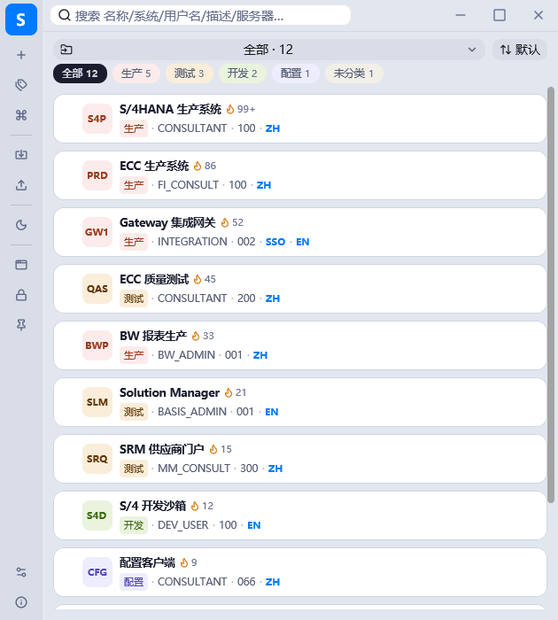
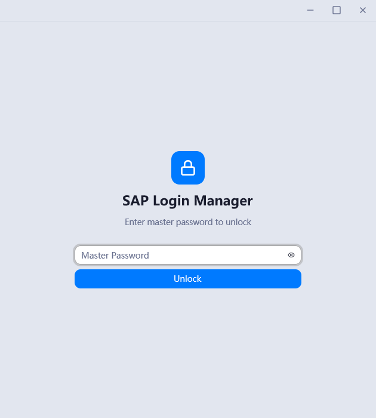
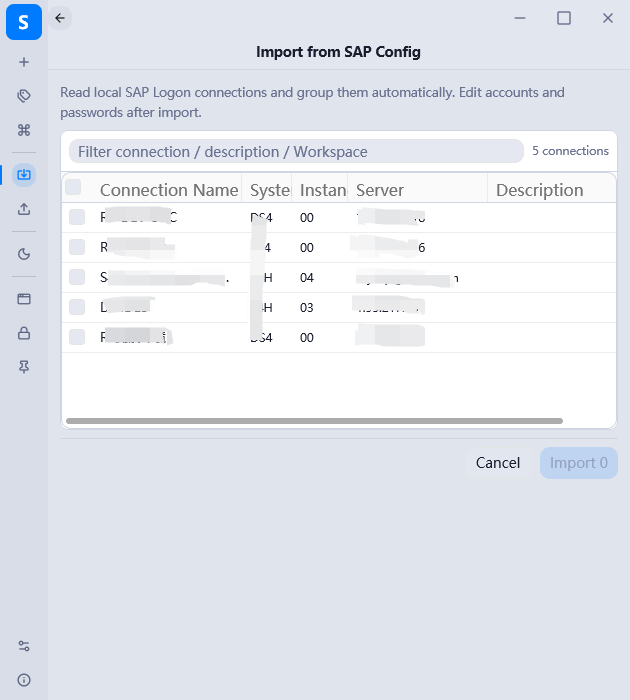
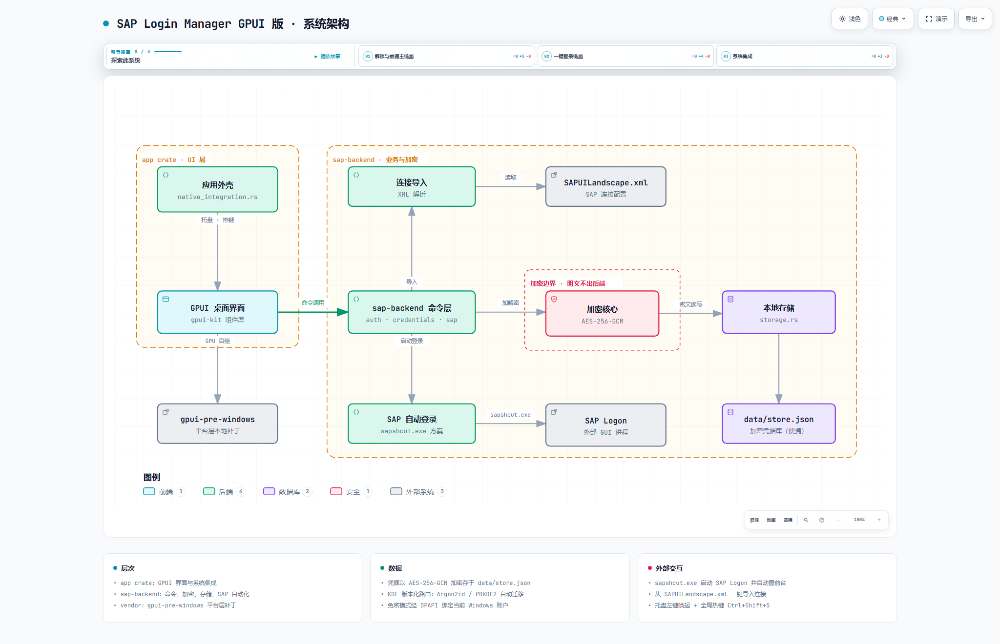

# SAP Login Manager

<p align="center">
  一款为 SAP 顾问与运维人员打造的<strong>本地化、加密存储、一键登录</strong>桌面凭据管理工具。
</p>

<p align="center">
  
  
  
  
  
</p>

---

## 📖 简介

**SAP Login Manager** 是一个 **Rust 原生（GPUI）** 的轻量级 Windows 桌面应用，用于集中管理 SAP 系统的登录凭据：所有数据使用 **AES-256-GCM** 加密后**保存在本地**（无任何云端上传），支持从 `SAPUILandscape.xml` 导入连接、一键 / 批量启动 SAP Logon 登录，帮助你告别重复手动输入账号密码。

在开源生态中，现有的 SAP 自动化项目要么没有 GUI（CLI / 脚本 / MCP），要么凭据明文存于 CSV / JSON。本项目的差异化定位：

> **唯一同时具备「完整图形界面 + 强加密存储 + 一键登录」的开源 SAP 登录管理器**，且保持原生级资源占用（实测任务管理器内存约 17–20 MB，完整工作集含共享库约 50 MB；无 WebView 运行时）。

> 🔒 **隐私优先**：凭据仅存储在你自己的电脑上，密钥由主密码派生，明文密码永不落盘。

---

## ✨ 核心功能

### 凭据管理
- 增删改查 SAP 连接凭据：显示名称、System ID、集团（Client）、登录语言、环境、描述、应用服务器 / 消息服务器（负载均衡）、SAP Router、SNC / SSO
- **删除可撤销**（Undo 恢复），复制副本快速新建
- 复制密码一键完成，卡片上原地反馈 ✓

### 分组与筛选
- 按环境（正式 / 测试 / 开发 / 配置）系统分组 + 自定义分组，分组间移动凭据
- 分组下拉带数量徽标、分区可折叠，支持指定**启动默认分组**
- 收藏、置顶（卡片图钉标识）、四种排序方式（默认 / 常用 / 最近登录 / 名称）

### 搜索
- 全字段全局搜索（名称 / 系统 / 集团 / 用户名 / 服务器 / 描述 / 分组名…）
- **结构化语法**：`env:生产`（支持中英文别名）、`grp:分组名`，可叠加过滤

### 登录与自动化
- 一键启动 SAP Logon 并自动填充登录，双击卡片即登录
- **批量登录**：多选（勾选 / Ctrl / Shift 范围选）后逐条执行，可配置间隔，汇总成功明细
- 标题栏一键打开 SAP Logon：运行中自动置前台，未运行则启动；SAP Logon 路径可自定义
- 从 `SAPUILandscape.xml` 导入连接
- SNC 单点登录（SSO）凭据支持，负载均衡 / SAP Router 连接串

### 安全
- 主密码保护；密钥派生**版本化路由**：新库直接使用 **Argon2id**（19 MiB / t=2），旧版（PBKDF2 600k）库在解锁时自动安全升级
- 数据 **AES-256-GCM** 加密（带完整性认证）
- **免密模式（仅本次运行有效）**：校验主密码后，本次运行内锁定 / 解锁无需重复输入；主密码只驻留内存、**不落盘**，应用退出即失效
- 主密码运行时以 `SecretString` 保存，销毁时内存清零（zeroize）
- 剪贴板定时自动清空（可配置）、空闲自动锁定（时长可配置，0 为禁用）
- 备份导出 / 导入（加密凭据包），便于迁移与灾备

### 体验
- 中文 / English 双语界面，亮色 / 暗色主题（活动栏一键切换）
- 左侧活动栏集中入口：分组管理、导入 / 导出、主题切换、打开 SAP Logon
- 环境色标识（左缘色条 + 浅底头像 + 环境标签，色弱友好）
- 命令面板（`Ctrl+K`）、应用内快捷键（`Ctrl+N` 新增 / `Ctrl+F` 搜索 / `Ctrl+L` 锁定）、键盘导航（`↑↓` 选择 / `Enter` 登录）
- **全局热键 `Ctrl+Shift+S`**：任意界面唤起窗口并弹出命令面板（Raycast 式入口）
- 系统托盘（左键唤起主窗口；最小化 / 关闭到托盘可配置）、开机自启、紧凑密度模式
- 窗口置顶开关、界面字体自定义

---

## 🖼️ 界面预览

<p align="center">
  <picture>
    <source media="(prefers-color-scheme: dark)" srcset="demo-data/screenshot/main-dark-en.png">
    
  </picture>
</p>

<p align="center">
  &nbsp;&nbsp;
  
</p>

> 截图由 `demo-data/` 演示实例生成（12 条演示凭据，测试主密码见 `demo-data/使用说明.txt`）。

---

## 🏗️ 系统架构

<picture>
  <source media="(prefers-color-scheme: dark)" srcset="docs/architecture-dark.png">
  
</picture>

> 交互式架构图：**[docs/architecture.html](docs/architecture.html)** —— 单文件、离线可开，内置「解锁与数据主链路 / 一键登录 / 系统集成」三个视角视图与组件悬浮详情。图源 [docs/architecture.json](docs/architecture.json)（经 [Archify](https://github.com/tt-a1i/archify) showcase 质量校验生成）。

---

## 📦 目录结构

仓库本身就是 Cargo workspace，克隆后直接在根目录构建：

```text
sap-login-manager/
├── app/                  # UI 层（sap-login-manager-gpui：GPUI + gpui-kit 组件库）
├── backend/              # 业务与加密（sap-backend：凭据 / 加密 / SAP 自动化）
├── vendor/
│   └── gpui-pre-windows/ # gpui-pre 本地补丁（修复窗口左/右/底边缘缩放命中区）
├── .cargo/config.toml    # 国内镜像源（rsproxy）加速依赖下载
├── docs/                 # BUILDING.md 构建说明 + architecture.* 系统架构图（HTML / 图源 / 预览图）
└── build.ps1             # 一键构建脚本（check / build / run × debug / release）

仓库根的 `build-gpui.ps1` 另支持第三参数选择目标架构（x86 / x64 / arm64）。
```

---

## 🚀 快速开始

### 方式一：下载成品（推荐）
1. 前往 [Releases](https://github.com/sfhzyq/SAP-LoginManager/releases/latest)，按 CPU 架构下载：

   | 文件 | 架构 | 适用场景 |
   |---|---|---|
   | `sap-login-manager-gpui-x64.exe` | x86_64（64 位） | 绝大多数 Windows 10/11 电脑（推荐） |
   | `sap-login-manager-gpui-x86.exe` | i686（32 位） | 32 位 Windows / 老旧终端 |
   | `sap-login-manager-gpui-arm64.exe` | ARM64（aarch64） | Windows 11 on ARM、Apple Silicon 虚拟机 |

   > ARM 指 **ARM64（aarch64）**，不支持 32 位 ARM。三者均为约 22–28 MB 的免安装单文件、无运行时依赖；每个 Release 附 `SHA256SUMS.txt` 供校验。
2. 将 exe 移到独立目录运行 —— 便携模式，首次启动自动创建同目录 `data\` 存储库
3. 首次启动设置主密码即可使用；可在设置中开启「免密模式」（仅在本次运行内有效，主密码不落盘）

### 方式二：从源码构建

#### 环境要求
- Windows 10/11
- [Rust](https://www.rust-lang.org/tools/install) **1.88 或更高**（见 `Cargo.toml` 的 `rust-version`）

#### 构建与运行
```powershell
.\build.ps1 check          # 快速编译检查
.\build.ps1 build release  # release 构建
.\build.ps1 run            # 编译并运行
```
或直接使用 cargo：
```powershell
cargo build --release -p sap-login-manager-gpui
```

多架构构建请使用仓库根的 `build-gpui.ps1`（第三参数 `x86` / `x64` / `arm64`）：
```powershell
..\build-gpui.ps1 build release x86    # target\i686-pc-windows-msvc\release\
..\build-gpui.ps1 build release arm64  # target\aarch64-pc-windows-msvc\release\
```

### 数据存储
- 数据文件位于 **exe 同目录 `data/store.json`**（便携模式，拷贝目录即迁移）
- ⚠️ 请勿在源码目录内正式使用（`cargo clean` 会连带清空）；建议将 exe 与 `data/` 复制到独立目录

---

## 🧱 技术栈

| 层 | 技术 |
| --- | --- |
| UI 框架 | [GPUI](https://gpui.rs)（Zed 的 GPU 加速自绘框架）+ [gpui-kit](https://github.com/longbridge/gpui-component) 组件库 |
| 后端 | Rust（stable），workspace：`sap-backend`（业务/加密）+ `sap-login-manager-gpui`（UI） |
| 加密 | AES-256-GCM、Argon2id / PBKDF2-HMAC-SHA256（KDF 版本路由）、Windows DPAPI（历史兼容模块，v1.6.0 起免密模式不再写入磁盘） |
| 存储 | 本地 JSON（`data/store.json`，便携化） |
| 托盘/自启 | tray-icon + 注册表（HKCU Run 键，路径自愈） |

---

## 🔐 安全说明

- 主密码**不会**以任何形式明文存储，仅保存其哈希用于校验；加密密钥由主密码 + 随机盐经 KDF 派生。
- **KDF 版本化路由**：v0 = 旧版格式，v1 = PBKDF2（600,000 轮），v2 = **Argon2id**（19 MiB / t=2，当前最新）。设置或修改主密码、以及每次解锁时，旧版本库自动原子迁移到最新版（重加密过渡）。
- 所有凭据密码使用 AES-256-GCM 加密，具备防篡改完整性认证。
- **免密模式**仅在**本次运行内**缓存已校验的主密码，**不写入磁盘**；应用重启后仍需输入主密码。v1.6.0 之前曾用 Windows DPAPI 把密文写入 `remembered_master`，该字段现已废弃，开启免密或修改主密码时会自动清除历史密文。
- 主密码与解密密码在内存中以 `SecretString` / zeroize 管理，Drop 时清零，`Debug` 输出打码。

---

## 🤝 反馈

- 问题与建议：[GitHub Issues](https://github.com/sfhzyq/SAP-LoginManager/issues)
- 邮箱：`sfhzyq@qq.com`

## 📄 许可证

本项目采用 [MIT](./LICENSE) 许可证。
